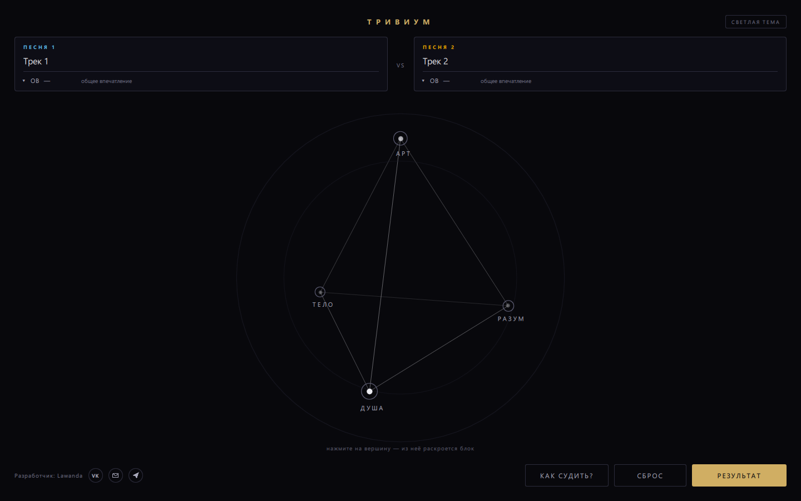
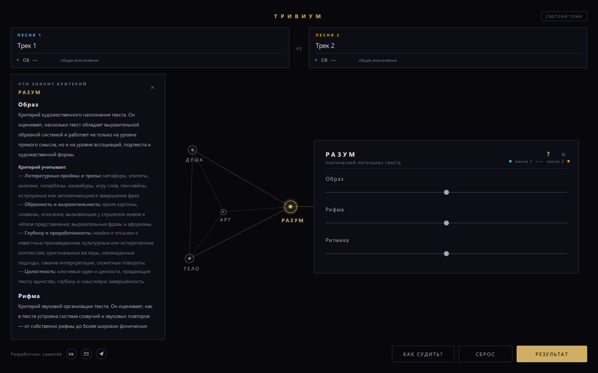
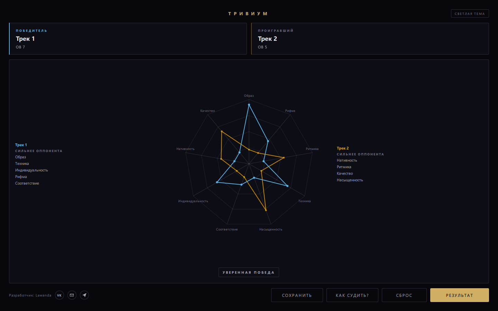
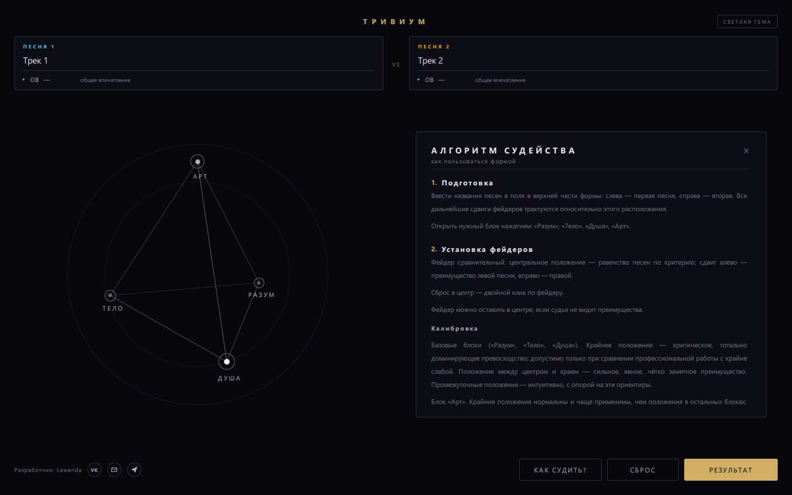
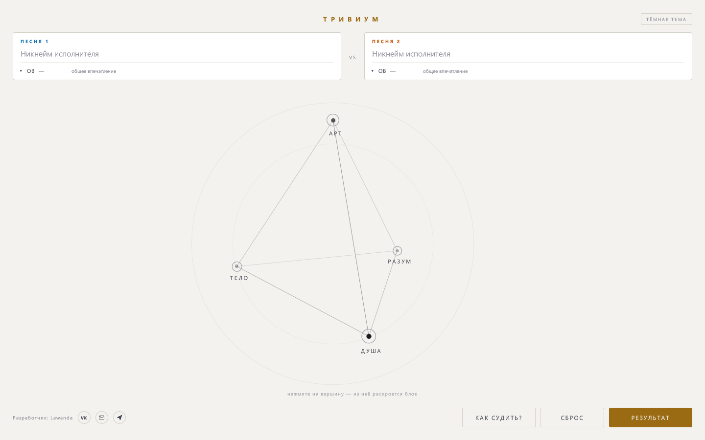

# Тривиум

Десктопное приложение для сравнительного судейства двух песен.
Судья двигает фейдеры «левее / правее», выражая, какая песня сильнее по каждому
критерию, и получает разбор: победителя, радар по девяти критериям и то,
что каждая песня забрала у оппонента.

Python + PySide6 (Qt Quick). Работает офлайн, ничего никуда не отправляет,
без аккаунтов, подписок и лицензионных ключей.

Репозиторий: https://github.com/lawagg/trivium



<details>
<summary>Ещё скриншоты</summary>






</details>

---

## Что умеет

* **Четыре блока судейства** на вершинах тетраэдра: «Разум», «Тело», «Душа» —
  базовые, «Арт» — коэффициентный.
* **Девять базовых критериев** с фейдерами сравнения: судья показывает, какая
  песня сильнее по каждому критерию, и насколько.
* **Блок «Арт»** усиливает результат той песни, которая в нём впереди.
* **Общее впечатление (ОВ)** 0–10 для каждой песни; на победителя не влияет,
  кроме ничьей.
* **Результат** — карточки песен, радар по девяти критериям, списки «сильнее
  оппонента», вердикт («Ничья», «Переворот Артом», «На грани», «Уверенная
  победа», «Разгром»).
* **Справка «Как судить?»** и пояснения к каждому критерию прямо в форме.
* **Светлая и тёмная тема** — переключается кнопкой в шапке.
* **Сохранение результата** — кнопка «Сохранить» делает JPEG-снимки всех четырёх
  блоков и страницы результата в выбранную папку; имена файлов подставляются
  из названий песен.

Полное техническое задание и принятые решения — в [docs/tz.md](docs/tz.md).

---

## Запуск

### Готовые сборки

Скачайте архив из раздела **[Releases](https://github.com/lawagg/trivium/releases)**
и распакуйте в любую папку:

* Windows — `Trivium\Trivium.exe`;
* macOS — `Trivium.app` (правый клик → «Открыть»).

Ни установки, ни прав администратора не требуется.

> Сборки не подписаны сертификатом. Windows при первом запуске может показать
> «Система Windows защитила ваш компьютер» — нажмите «Подробнее» →
> «Выполнить в любом случае». Это не вирус: так Windows реагирует на любой
> файл без цифровой подписи. Подробнее — [docs/SIGNING.md](docs/SIGNING.md).

### Из исходников

```bash
pip install -r requirements.txt
python main.py
```

Проверка математики (Qt не нужен):

```bash
python tests/test_scoring.py
```

Служебные проверки интерфейса без открытия окна:

```bash
python tools/check_qml.py     # форма загружается
python tools/check_flow.py    # заполнение → «Результат» → сброс
python tools/grab.py          # рендер экранов в tools/shots/
```

---

## Как это работает

Судья выставляет фейдеры по каждому критерию и нажимает «Результат».
Расчёт целиком выполняется внутри приложения: промежуточные значения и баллы
на экран не выводятся — виден только итог: кто победил и по каким критериям
он оказался сильнее.

Никакие данные никуда не отправляются, интернет не требуется.

---

## Сборка

Нужен PyInstaller и спецификация [Trivium.spec](Trivium.spec) — она общая
для Windows и macOS.

**Windows**

```powershell
powershell -ExecutionPolicy Bypass -File build_windows.ps1
```

Результат: папка `dist\Trivium\` и архив `dist\Trivium-Windows.zip`.
Одноместный файл: `build_windows.ps1 -OneFile` (распаковывается в `%TEMP%`
при каждом запуске — антивирус реагирует чаще).

**macOS**

```bash
bash build_macos.sh
```

Результат: `dist/Trivium.app`.

PyInstaller не кросс-компилирует: `.exe` собирается на Windows, `.app` — на macOS.

Иконка пересобирается скриптом `tools/make_icon.py` (нужен Pillow).

---

## Структура

```
main.py                 точка входа, подключение QML и моста
trivium/scoring.py      вся математика судейства (без Qt)
trivium/texts.py        определения критериев и алгоритм судейства
trivium/bridge.py       мост QML ↔ Python
qml/Main.qml            окно: раскладка, состояние, логика формы
qml/Tetra.qml           сцена-тетраэдр с вершинами
qml/FaderPanel.qml      панель блока, растущая из вершины
qml/CriteriaInfo.qml    пояснения к критериям
qml/HelpPanel.qml       справка «Как судить?»
qml/ResultView.qml      экран результата
qml/RadarChart.qml      радар по девяти критериям
qml/ScoreList.qml       список «сильнее оппонента»
qml/DetentFader.qml     фейдер сравнения (без чисел)
qml/OvFader.qml         фейдер ОВ (с числами и рисками)
qml/SongCard.qml        карточка песни: никнейм + ОВ
qml/ResultCard.qml      карточка победителя / проигравшего
qml/FlatButton.qml      кнопка
qml/SocialLink.qml      иконки-ссылки
qml/Palette.js          палитра (графит + латунь)
qml/Seg.qml             отрезок для радара
docs/                   ТЗ, лицензии, инструкция по подписи
tests/                  проверки расчётов
tools/                  служебные скрипты и скриншоты
```

Набор критериев и подписи живут в `BLOCKS` (`trivium/scoring.py`) — форма
строится из них.

---

## Лицензия

Код — [MIT](LICENSE).
В сборку входят Qt и PySide6 под LGPL v3 — см. [docs/THIRD-PARTY-NOTICES.md](docs/THIRD-PARTY-NOTICES.md).
